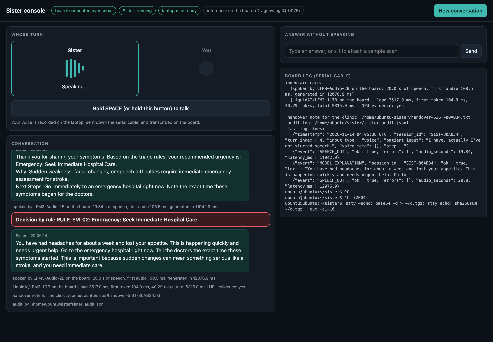
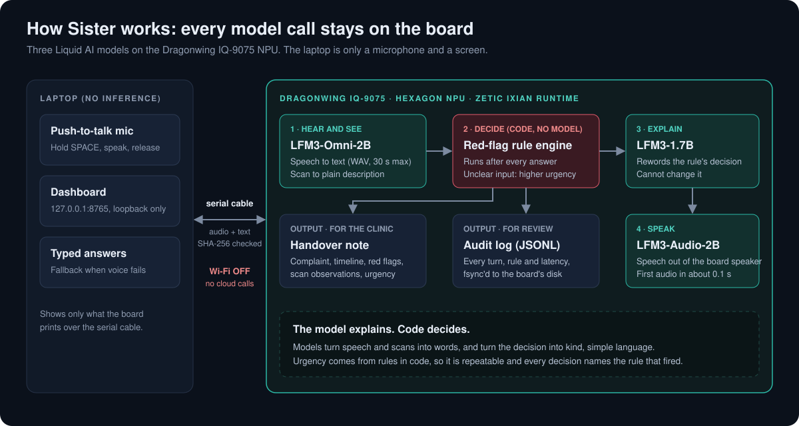
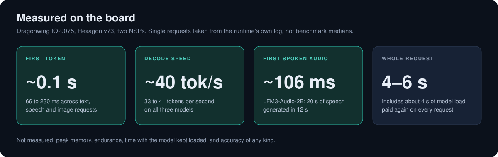

<h1 align="center">Sister</h1>
<p align="center"><b>An offline nurse's assistant that listens, speaks and triages on a Dragonwing IQ-9075, using only Liquid AI models.</b></p>
<p align="center">
  
  
  
  
</p>

"Sister" is what a nurse is called in South Africa. In a remote rural clinic there may be no internet, and
reaching a district hospital costs real time and money. Sister interviews a patient by voice, checks every
answer against red-flag rules, tells the patient in plain spoken words how urgently they need care, and
prints a handover note for the clinician. All of it runs on one board with the Wi-Fi switched off.

> **Hackathon prototype.** The rules and questionnaire are synthetic and have not been reviewed by a
> clinician. Sister is not a medical device and must not be used for real patient care.



*The dashboard during a real session: the patient said "I've got slurred speech", rule `RULE-EM-02` fired,
and Sister spoke the result. Every line on this page was parsed from what the board printed over the serial cable.*

## Why this is not a cloud API call

| Constraint | What it means for Sister |
|---|---|
| **No network** | The clinics this is for have no reliable internet. Sister's core workflow makes no network request, and no cloud fallback is configured anywhere in the code. |
| **Sensitive data** | A patient's voice, symptoms and scans never leave the board. The audit log and handover note are written to its local disk. |
| **Responsiveness** | First token arrives in about 0.1 s and speech starts in about 0.1 s, with no round trip to a data centre. |
| **Flat cost** | One board, no per-request fee, however many patients are seen. |

## How it works



1. **Hear.** The patient holds SPACE and speaks. The recording goes down the serial cable (checked with
   SHA-256 on arrival) and **LFM3-Omni-2B** transcribes it on the board. Sister shows what it heard so the
   patient can confirm or answer again.
2. **Decide.** A rule engine in plain Python ([backend/triage_rules.py](backend/triage_rules.py)) runs after
   every answer. An emergency answer stops the interview at once. If the input is unclear, the rules pick the
   higher urgency. No model takes part in this step.
3. **Explain.** **LFM3-1.7B** is given the decision the rule already made and rewords it in two or three
   simple sentences. Its prompt forbids changing the decision or naming a disease.
4. **Speak.** **LFM3-Audio-2B** turns Sister's words into speech on the board and plays it through the board's speaker.
5. **Record.** Sister writes a one-page handover note for the clinic and appends every turn, rule and
   latency to a JSONL audit log that is flushed to disk with `fsync`.

### Only Liquid AI models

Every model call in Sister goes to a Liquid AI LFM3 model staged on the board and run on the Hexagon NPU
through the ZETIC Ixian runtime ([backend/liquid_engine.py](backend/liquid_engine.py)). There is no other
model, no hosted API and no fallback.

| Job | Model | Limits set in code |
|---|---|---|
| Speech to text | `LiquidAI/LFM3-Omni-2B` | One WAV, up to 30 s, 128 tokens |
| Scan description | `LiquidAI/LFM3-Omni-2B` | One 512x512 image, 120 tokens, observations only |
| Plain-language explanation and answer extraction | `LiquidAI/LFM3-1.7B` | 160 tokens, at most two attempts |
| Text to speech | `LiquidAI/LFM3-Audio-2B` | Female voice, American English |

Nothing is simulated. If a model is missing or its answer fails validation, the call returns an error and
Sister asks the patient to type instead, or falls back to the fixed rule text. It never invents an answer.

### The model explains, code decides

A language model can drift or make things up, which is not acceptable when the output is "go to hospital
now" or "you can wait". So Sister splits the work:

- **Models handle language:** speech into text, a scan into a description, a decision into kind words.
- **Code handles judgement:** urgency comes from named rules (`RULE-EM-01` to `05` for emergencies,
  `RULE-CL-01` to `04` for a clinic visit, `RULE-SAFETY-S3` as the cautious default). The same answers always
  give the same result, and each decision names the rule that fired.
- **Scans never set urgency.** The model's description is recorded for the clinician only.

## Measured on the board



Dragonwing IQ-9075, Ubuntu 24.04, ZETIC Ixian Hexagon SDK 0.2.1, v73 two-NSP packages, 2026-11-13. These
are **single requests, not benchmarks**: one sample each, no medians. Every request starts a fresh process,
so each one pays the model load.

| Request | Model | Model load | First token | Decode | Whole request |
|---|---|---|---|---|---|
| Text, one sentence | LFM3-1.7B | 3.7 s | 66 ms | 37 tok/s | 4.1 s |
| Explain a triage decision (about 80 tokens) | LFM3-1.7B | 3.6 s | 121 ms | 40 tok/s | 6.3 s |
| One 512x512 image, described | LFM3-Omni-2B | 4.2 s | 230 ms | 38 tok/s | 5.0 s |
| 11 s WAV, transcribed | LFM3-Omni-2B | 4.2 s | 143 ms | 40 tok/s | 5.1 s |
| Spoken question to spoken reply (8.8 s of speech) | LFM3-Audio-2B | 3.9 s | 119 ms, first audio 277 ms | 33 tok/s | under 6 s |

Each request's log showed the Hexagon runtime opening on v73 with two NSPs. Not measured: peak memory,
endurance, time with the model kept loaded, and accuracy of any kind.

## Run the demo

On the laptop that holds the board's micro-USB serial cable (needs Python 3 and ffmpeg):

```bash
python3 tools/sister_console.py --start
```

This opens the serial console, starts Sister on the board in speaking mode, and serves the dashboard at
`http://127.0.0.1:8765` (loopback only, no external assets). Hold SPACE to talk and release to send.

On the board itself, with the models staged in `~/zetic-demo`:

```bash
python3 sister_voice_demo.py --speak
```

Type an answer or a choice number, `v samples/sample_patient_answer.wav` to answer from a WAV file, or
`s 5` at the scan question to attach a sample scan.

### Two-minute judge script

1. Turn the board's Wi-Fi off: `sudo nmcli radio wifi off`, then `nmcli -p device`.
2. Start the console and open the dashboard.
3. Answer Sister's questions by voice. Say a red-flag symptom such as slurred speech.
4. Show the red decision banner with the rule ID, and hear Sister explain it aloud.
5. Show the model timing lines and the audit log lines in the board log panel.

## SAMPLE history interview

A second, longer interview follows the SAMPLE history format: 41 possible questions with conditional
branches and explicit "unknown" and "declined" answers
([questionnaire](docs/sister-questionnaire-v1/QUESTIONNAIRE.md)). LFM3-1.7B extracts structured answers
from free text against a JSON schema, with at most two attempts; malformed output produces a visible error,
never invented patient facts. Reported safety concerns interrupt the interview, and no branch recommends
self-care. The summary can be edited and downloaded.

```bash
python3 -m venv .venv
.venv/bin/pip install -r requirements.txt
.venv/bin/python start.py        # web UI at http://127.0.0.1:8080
python3 sister_cli.py            # terminal version, add --speak for voice
```

## What is and is not real

- **Real, on the board:** speech to text, the plain-language explanation, text to speech, and the rule
  decision, run end to end by voice through `sister_voice_demo.py` and the dashboard.
- **Rules and questionnaire are synthetic.** They were not reviewed by a clinician and are not taken from
  a published protocol.
- **Sample scans are synthetic drawings,** not real X-rays or MRIs. How the model does on real scans is
  untested.
- **`backend/imaging_analyzer.py` is not a model.** It is pixel heuristics from an earlier version, and its
  bounding boxes do not come from a model.
- **The SAMPLE interview has not been run on the board with the voice console.** Its tests use model test
  doubles, so they check routing and integration, not extraction accuracy.
- **The board has no working microphone,** so the laptop records the patient's voice and sends it over the serial cable. Sister's speech is generated on the board and played through the board's speaker.
- `tests/test_direct_units.py`, `test_in_process.py` and `test_end_to_end.py` were written for an earlier
  simulated engine and have not been updated.

## Tests

```bash
.venv/bin/pip install -r requirements-dev.txt
.venv/bin/python -m pytest tests/test_sample_app.py -q
.venv/bin/python -m unittest discover -s docs/sister-questionnaire-v1 -p test_controller.py -q
```

## Repository

```
backend/
  liquid_engine.py       The only path to a model: LFM3 through the ZETIC Ixian runtime
  triage_rules.py        Red-flag rules that decide urgency
  sample_interview.py    SAMPLE history interview and extraction
  session_manager.py     Interview state and the fsync'd audit log
  handover_generator.py  One-page note for the clinician
  main.py                FastAPI app for the web UI
sister_voice_demo.py     Voice interview run on the board
sister_cli.py            SAMPLE interview in the terminal
tools/
  sister_console.py      Laptop side: serial console, push-to-talk, dashboard server
  dashboard.py           The dashboard page (standard library only)
docs/sister-questionnaire-v1/   Questionnaire, prompts, schema and controller
samples/                 Synthetic scans and a sample WAV
```

Built at the Cleared for Takeoff on-device hackathon, November 2026.
